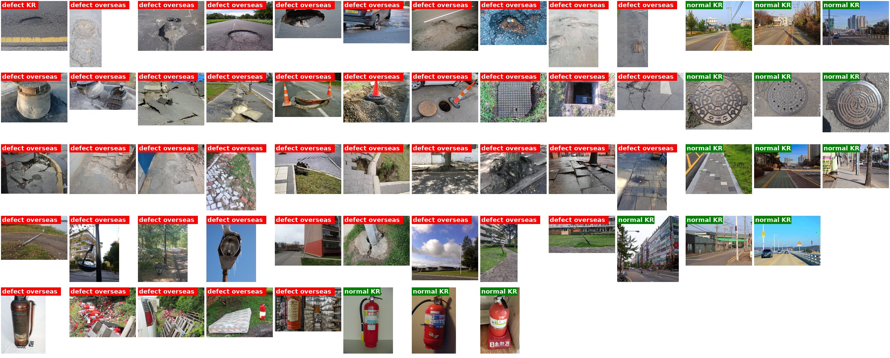

# yanju_ref

도로·보행 시설물 파손 분류용 소규모 이미지 데이터셋 (PNG, 최대 너비 800px).

## 구성

| 항목 | defect | normal |
|---|---|---|
| pothole | 10 | 3 |
| manhole | 10 | 3 |
| sidewalk_block | 10 | 3 |
| streetlight | 9 | 3 |
| fire_extinguisher | 5 | 3 |

- `<category>/<defect|normal>/<category>_<label>_NN.png`
- `labels.csv`: file, category, label, region(KR/overseas), source_title, source_url, license, author
- 한국 파손 사진을 찾기에는 조금 제한이 있어 정상(normal) 이미지는 모두 한국 사진이고, 파손(defect) 이미지는 대부분 해외 사진입니다. 그러나 지역 편향은 크게 있을 것 같진 않습니다.

## 라이선스 및 저작자 표기

모든 이미지는 [Wikimedia Commons](https://commons.wikimedia.org)에서 가져왔으며, 각 이미지는 원본의 라이선스를 따릅니다.
CC BY-SA 이미지를 수정·재배포할 경우 같은 라이선스를 하고, 원본은 JPEG에서 PNG로 변환하고 축소했습니다.

| 파일 | 원본 | 저작자 | 라이선스 |
|---|---|---|---|
| `pothole/defect/pothole_defect_01.png` | [File:Roadhole in Korea.jpg](https://commons.wikimedia.org/wiki/File:Roadhole_in_Korea.jpg) | revi | CC BY 2.0 kr |
| `pothole/defect/pothole_defect_02.png` | [File:Pothole on local Road in County Monaghan.jpg](https://commons.wikimedia.org/wiki/File:Pothole_on_local_Road_in_County_Monaghan.jpg) | Computerfan0 | CC0 |
| `pothole/defect/pothole_defect_03.png` | [File:Pothole in Villeray, Montréal.jpg](https://commons.wikimedia.org/wiki/File:Pothole_in_Villeray,_Montr%C3%A9al.jpg) | Miguel Tremblay | Public domain |
| `pothole/defect/pothole_defect_04.png` | [File:Pothole Big.jpg](https://commons.wikimedia.org/wiki/File:Pothole_Big.jpg) | Uncl3dad | Public domain |
| `pothole/defect/pothole_defect_05.png` | [File:A pothole in Dilova Street in Kyiv.jpg](https://commons.wikimedia.org/wiki/File:A_pothole_in_Dilova_Street_in_Kyiv.jpg) | Роман Рябенко | CC0 |
| `pothole/defect/pothole_defect_06.png` | [File:Potholes - at the junction of Philip Lane N15 and Mount Pleasant Road N17.jpg](https://commons.wikimedia.org/wiki/File:Potholes_-_at_the_junction_of_Philip_Lane_N15_and_Mount_Pleasant_Road_N17.jpg) | Alan Stanton | CC BY-SA 2.0 |
| `pothole/defect/pothole_defect_07.png` | [File:Banbury's Bretch Hill Pothole, 2010.png](https://commons.wikimedia.org/wiki/File:Banbury%27s_Bretch_Hill_Pothole,_2010.png) | Snow storm in Eastern Asia at en.wikipedia | Public domain |
| `pothole/defect/pothole_defect_08.png` | [File:Pothole in an asphalt pavement.jpg](https://commons.wikimedia.org/wiki/File:Pothole_in_an_asphalt_pavement.jpg) | Frankie Fouganthin | CC BY-SA 4.0 |
| `pothole/defect/pothole_defect_09.png` | [File:Potholes in a road in Gaborone.jpg](https://commons.wikimedia.org/wiki/File:Potholes_in_a_road_in_Gaborone.jpg) | Chandapiwa Malema | CC BY-SA 4.0 |
| `pothole/defect/pothole_defect_10.png` | [File:Straßenschäden viele Schlaglöcher, katastrophaler Asphaltbelag (2024-08-11) 03.jpg](https://commons.wikimedia.org/wiki/File:Stra%C3%9Fensch%C3%A4den_viele_Schlagl%C3%B6cher,_katastrophaler_Asphaltbelag_(2024-08-11)_03.jpg) | Goestratal! | CC BY-SA 4.0 |
| `pothole/normal/pothole_normal_01.png` | [File:Hwaseong City Hwaseong-ro Road 20240803 (02).jpg](https://commons.wikimedia.org/wiki/File:Hwaseong_City_Hwaseong-ro_Road_20240803_(02).jpg) | LandAndTree | CC0 |
| `pothole/normal/pothole_normal_02.png` | [File:Anseong City Seokjeong-dong Seokjeong 2-gil 20250101 (02).jpg](https://commons.wikimedia.org/wiki/File:Anseong_City_Seokjeong-dong_Seokjeong_2-gil_20250101_(02).jpg) | LandAndTree | CC0 |
| `pothole/normal/pothole_normal_03.png` | [File:Gunpo City Sanboncheon-ro 20250118 (02).jpg](https://commons.wikimedia.org/wiki/File:Gunpo_City_Sanboncheon-ro_20250118_(02).jpg) | LandAndTree | CC BY-SA 4.0 |
| `manhole/defect/manhole_defect_01.png` | [File:Manhole shows subsidence occurred by 2011 Sendai earthquake.jpg](https://commons.wikimedia.org/wiki/File:Manhole_shows_subsidence_occurred_by_2011_Sendai_earthquake.jpg) | On-chan | CC0 |
| `manhole/defect/manhole_defect_02.png` | [File:液状化現象の記憶(高洲中央公園).jpg](https://commons.wikimedia.org/wiki/File:%E6%B6%B2%E7%8A%B6%E5%8C%96%E7%8F%BE%E8%B1%A1%E3%81%AE%E8%A8%98%E6%86%B6(%E9%AB%98%E6%B4%B2%E4%B8%AD%E5%A4%AE%E5%85%AC%E5%9C%92).jpg) | Souka Kinmei | CC0 |
| `manhole/defect/manhole_defect_03.png` | [File:北海道胆振東部地震により札幌市清田区で発生した液状化現象.jpg](https://commons.wikimedia.org/wiki/File:%E5%8C%97%E6%B5%B7%E9%81%93%E8%83%86%E6%8C%AF%E6%9D%B1%E9%83%A8%E5%9C%B0%E9%9C%87%E3%81%AB%E3%82%88%E3%82%8A%E6%9C%AD%E5%B9%8C%E5%B8%82%E6%B8%85%E7%94%B0%E5%8C%BA%E3%81%A7%E7%99%BA%E7%94%9F%E3%81%97%E3%81%9F%E6%B6%B2%E7%8A%B6%E5%8C%96%E7%8F%BE%E8%B1%A1.jpg) | 北海道開発局 | CC BY 4.0 |
| `manhole/defect/manhole_defect_04.png` | [File:Chuetsu earthquake-earthquake liquefaction1.jpg](https://commons.wikimedia.org/wiki/File:Chuetsu_earthquake-earthquake_liquefaction1.jpg) | No machine-readable author provided. Tubbi assumed (based on copyright claims). | CC BY-SA 3.0 |
| `manhole/defect/manhole_defect_05.png` | [File:Earthquake damage, Lower Styx Road, Brooklands 2.jpg](https://commons.wikimedia.org/wiki/File:Earthquake_damage,_Lower_Styx_Road,_Brooklands_2.jpg) | Jim Harding | CC BY-SA 2.0 |
| `manhole/defect/manhole_defect_06.png` | [File:2004 Chuetsu earthquake Uplift of manhole, Nagaoka 03.jpg](https://commons.wikimedia.org/wiki/File:2004_Chuetsu_earthquake_Uplift_of_manhole,_Nagaoka_03.jpg) | Naoki Sato | CC BY-SA 2.0 |
| `manhole/defect/manhole_defect_07.png` | [File:Open Manhole - New Orleans September 2020.jpg](https://commons.wikimedia.org/wiki/File:Open_Manhole_-_New_Orleans_September_2020.jpg) | Bart Everson | CC BY 2.0 |
| `manhole/defect/manhole_defect_08.png` | [File:Broken Manhole Cover De Globe Tegelen.jpg](https://commons.wikimedia.org/wiki/File:Broken_Manhole_Cover_De_Globe_Tegelen.jpg) | Sindala | CC BY 4.0 |
| `manhole/defect/manhole_defect_09.png` | [File:Broken manhole cover - geograph.org.uk - 4338943.jpg](https://commons.wikimedia.org/wiki/File:Broken_manhole_cover_-_geograph.org.uk_-_4338943.jpg) | Richard Webb | CC BY-SA 2.0 |
| `manhole/defect/manhole_defect_10.png` | [File:Broken road in Hualien earthquake.jpg](https://commons.wikimedia.org/wiki/File:Broken_road_in_Hualien_earthquake.jpg) | NHC | CC BY-SA 4.0 |
| `manhole/normal/manhole_normal_01.png` | [File:Goheung manhole cover.jpg](https://commons.wikimedia.org/wiki/File:Goheung_manhole_cover.jpg) | Sarang | Public domain |
| `manhole/normal/manhole_normal_02.png` | [File:Manhole cover depicting symbol of Seoul City in 2018.jpg](https://commons.wikimedia.org/wiki/File:Manhole_cover_depicting_symbol_of_Seoul_City_in_2018.jpg) | Garam | Attribution |
| `manhole/normal/manhole_normal_03.png` | [File:Street cover water.jpg](https://commons.wikimedia.org/wiki/File:Street_cover_water.jpg) | Sarang | Public domain |
| `sidewalk_block/defect/sidewalk_block_defect_01.png` | [File:Acera quebrada de concreto no reparada en Maracay, Venezuela.jpg](https://commons.wikimedia.org/wiki/File:Acera_quebrada_de_concreto_no_reparada_en_Maracay,_Venezuela.jpg) | Bobjgalindo | CC BY 4.0 |
| `sidewalk_block/defect/sidewalk_block_defect_02.png` | [File:Damaged sidewalk in Montevideo - 01.jpg](https://commons.wikimedia.org/wiki/File:Damaged_sidewalk_in_Montevideo_-_01.jpg) | NaBUru38 | CC BY-SA 4.0 |
| `sidewalk_block/defect/sidewalk_block_defect_03.png` | [File:Damaged sidewalk in Montevideo - 02.jpg](https://commons.wikimedia.org/wiki/File:Damaged_sidewalk_in_Montevideo_-_02.jpg) | NaBUru38 | CC BY-SA 4.0 |
| `sidewalk_block/defect/sidewalk_block_defect_04.png` | [File:Germantown Johnson St bricks walkway 2026-06-19.jpg](https://commons.wikimedia.org/wiki/File:Germantown_Johnson_St_bricks_walkway_2026-06-19.jpg) | Kreuz und quer | CC0 |
| `sidewalk_block/defect/sidewalk_block_defect_05.png` | [File:Uszkodzona nawierzchnia w Ustce 02.jpg](https://commons.wikimedia.org/wiki/File:Uszkodzona_nawierzchnia_w_Ustce_02.jpg) | Klapka paradaja | CC BY 4.0 |
| `sidewalk_block/defect/sidewalk_block_defect_06.png` | [File:Uszkodzona nawierzchnia w Ustce 03.jpg](https://commons.wikimedia.org/wiki/File:Uszkodzona_nawierzchnia_w_Ustce_03.jpg) | Klapka paradaja | CC BY 4.0 |
| `sidewalk_block/defect/sidewalk_block_defect_07.png` | [File:2022-07-30 13 47 04 The roots of a Honey Locust lifting a large section of sidewalk along North Jackson Street between Delaware State Route 48 (West 2nd Street) and West 3rd Street in Wilmington, New Castle County, Delaware.jpg](https://commons.wikimedia.org/wiki/File:2022-07-30_13_47_04_The_roots_of_a_Honey_Locust_lifting_a_large_section_of_sidewalk_along_North_Jackson_Street_between_Delaware_State_Route_48_(West_2nd_Street)_and_West_3rd_Street_in_Wilmington,_New_Castle_County,_Delaware.jpg) | Famartin | CC BY-SA 4.0 |
| `sidewalk_block/defect/sidewalk_block_defect_08.png` | [File:2022-07-30 13 47 56 The roots of a Honey Locust lifting a large section of sidewalk along North Jackson Street between Delaware State Route 48 (West 2nd Street) and West 3rd Street in Wilmington, New Castle County, Delaware.jpg](https://commons.wikimedia.org/wiki/File:2022-07-30_13_47_56_The_roots_of_a_Honey_Locust_lifting_a_large_section_of_sidewalk_along_North_Jackson_Street_between_Delaware_State_Route_48_(West_2nd_Street)_and_West_3rd_Street_in_Wilmington,_New_Castle_County,_Delaware.jpg) | Famartin | CC BY-SA 4.0 |
| `sidewalk_block/defect/sidewalk_block_defect_09.png` | [File:031 Sidewalk environmental damage - dangerous sidewalk with concrete paving tiles, Bytom, Poland.jpg](https://commons.wikimedia.org/wiki/File:031_Sidewalk_environmental_damage_-_dangerous_sidewalk_with_concrete_paving_tiles,_Bytom,_Poland.jpg) | Marek Ślusarczyk (Tupungato) Photo portfolio | CC BY 3.0 |
| `sidewalk_block/defect/sidewalk_block_defect_10.png` | [File:A pavement on Philip Lane, Haringey, London 02.jpg](https://commons.wikimedia.org/wiki/File:A_pavement_on_Philip_Lane,_Haringey,_London_02.jpg) | Acabashi | CC BY-SA 4.0 |
| `sidewalk_block/normal/sidewalk_block_normal_01.png` | [File:Yeonamyulgeum-ro Sidewalk in Cheonan City 20270720.jpg](https://commons.wikimedia.org/wiki/File:Yeonamyulgeum-ro_Sidewalk_in_Cheonan_City_20270720.jpg) | LandAndTree | CC BY 4.0 |
| `sidewalk_block/normal/sidewalk_block_normal_02.png` | [File:Gunpo City Sanboncheon-ro 20250118 (01).jpg](https://commons.wikimedia.org/wiki/File:Gunpo_City_Sanboncheon-ro_20250118_(01).jpg) | LandAndTree | CC BY-SA 4.0 |
| `sidewalk_block/normal/sidewalk_block_normal_03.png` | [File:Seonjeong-dong, Anseong City, Gyeonggi-do 20250101 (01).jpg](https://commons.wikimedia.org/wiki/File:Seonjeong-dong,_Anseong_City,_Gyeonggi-do_20250101_(01).jpg) | LandAndTree | CC0 |
| `streetlight/defect/streetlight_defect_01.png` | [File:A fallen street light pole.jpg](https://commons.wikimedia.org/wiki/File:A_fallen_street_light_pole.jpg) | Niera | CC BY-SA 4.0 |
| `streetlight/defect/streetlight_defect_02.png` | [File:Damaged light donostia.JPG](https://commons.wikimedia.org/wiki/File:Damaged_light_donostia.JPG) | Joxemai | CC BY-SA 4.0 |
| `streetlight/defect/streetlight_defect_03.png` | [File:Decapitated lamppost in Central Park 01.jpg](https://commons.wikimedia.org/wiki/File:Decapitated_lamppost_in_Central_Park_01.jpg) | Jay Dobkin | CC BY-SA 4.0 |
| `streetlight/defect/streetlight_defect_04.png` | [File:Bechyňské schody, lampa s rampouchy.jpg](https://commons.wikimedia.org/wiki/File:Bechy%C5%88sk%C3%A9_schody,_lampa_s_rampouchy.jpg) | ŠJů (cs:ŠJů) | CC BY-SA 3.0 |
| `streetlight/defect/streetlight_defect_05.png` | [File:Libeň, nakloněná lampa.jpg](https://commons.wikimedia.org/wiki/File:Libe%C5%88,_naklon%C4%9Bn%C3%A1_lampa.jpg) | ŠJů | CC BY 4.0 |
| `streetlight/defect/streetlight_defect_06.png` | [File:Libeň, prasklý betonový základ lampy (01).jpg](https://commons.wikimedia.org/wiki/File:Libe%C5%88,_praskl%C3%BD_betonov%C3%BD_z%C3%A1klad_lampy_(01).jpg) | ŠJů | CC BY 4.0 |
| `streetlight/defect/streetlight_defect_07.png` | [File:Broken lamppost - streetlight on A899 Livingston Road - geograph.org.uk - 957464.jpg](https://commons.wikimedia.org/wiki/File:Broken_lamppost_-_streetlight_on_A899_Livingston_Road_-_geograph.org.uk_-_957464.jpg) | Simon Johnston | CC BY-SA 2.0 |
| `streetlight/defect/streetlight_defect_08.png` | [File:Zernikeplaats damaged street light, Ommoord, Rotterdam (2022) 01.jpg](https://commons.wikimedia.org/wiki/File:Zernikeplaats_damaged_street_light,_Ommoord,_Rotterdam_(2022)_01.jpg) | Donald Trung Quoc Don (Chữ Hán: 徵國單) - Wikimedia Commons - © CC BY-SA 4.0 International.(Want to use this image?)Original publication 📤: --Donald Trung 『徵國單』 (No Fake News 💬) (WikiProject Numismatics 💴) (Articles 📚) 18:16, 22 September 2022 (UTC) | CC BY-SA 4.0 |
| `streetlight/defect/streetlight_defect_09.png` | [File:Zernikeplaats damaged street light, Ommoord, Rotterdam (2022) 04.jpg](https://commons.wikimedia.org/wiki/File:Zernikeplaats_damaged_street_light,_Ommoord,_Rotterdam_(2022)_04.jpg) | Donald Trung Quoc Don (Chữ Hán: 徵國單) - Wikimedia Commons - © CC BY-SA 4.0 International.(Want to use this image?)Original publication 📤: --Donald Trung 『徵國單』 (No Fake News 💬) (WikiProject Numismatics 💴) (Articles 📚) 18:16, 22 September 2022 (UTC) | CC BY-SA 4.0 |
| `streetlight/normal/streetlight_normal_01.png` | [File:Dunsan-dong.jpg](https://commons.wikimedia.org/wiki/File:Dunsan-dong.jpg) | Ricksinkorea | CC BY-SA 3.0 |
| `streetlight/normal/streetlight_normal_02.png` | [File:Hwaseong City Hwaseong-ro Road 20240803 (01).jpg](https://commons.wikimedia.org/wiki/File:Hwaseong_City_Hwaseong-ro_Road_20240803_(01).jpg) | LandAndTree | CC0 |
| `streetlight/normal/streetlight_normal_03.png` | [File:Muui daegyo 1.jpg](https://commons.wikimedia.org/wiki/File:Muui_daegyo_1.jpg) | Wikiwater2020 | CC BY-SA 3.0 |
| `fire_extinguisher/defect/fire_extinguisher_defect_01.png` | [File:Fire extinguisher; Copper cannister; handle near top; hose attached to 1 side; Manufacturer's plate on side gives serial no (cd7ce805-be82-4e5c-9268-951816a54bbe).jpg](https://commons.wikimedia.org/wiki/File:Fire_extinguisher;_Copper_cannister;_handle_near_top;_hose_attached_to_1_side;_Manufacturer%27s_plate_on_side_gives_serial_no_(cd7ce805-be82-4e5c-9268-951816a54bbe).jpg) | National Park Service Picture – Courtesy of Hot Springs National Park Archives | Public domain |
| `fire_extinguisher/defect/fire_extinguisher_defect_02.png` | [File:Lendary Fire Extinguishers Graveyard, Lower Garden District, New Orleans May 2025 - 3.jpg](https://commons.wikimedia.org/wiki/File:Lendary_Fire_Extinguishers_Graveyard,_Lower_Garden_District,_New_Orleans_May_2025_-_3.jpg) | Infrogmation | CC BY-SA 4.0 |
| `fire_extinguisher/defect/fire_extinguisher_defect_03.png` | [File:Lendary Fire Extinguishers Graveyard, Lower Garden District, New Orleans May 2025 - 2.jpg](https://commons.wikimedia.org/wiki/File:Lendary_Fire_Extinguishers_Graveyard,_Lower_Garden_District,_New_Orleans_May_2025_-_2.jpg) | Infrogmation | CC BY-SA 4.0 |
| `fire_extinguisher/defect/fire_extinguisher_defect_04.png` | [File:Abandoned fire extinguisher (8631687046).jpg](https://commons.wikimedia.org/wiki/File:Abandoned_fire_extinguisher_(8631687046).jpg) | Newtown grafitti from Sydney, Australia | CC BY 2.0 |
| `fire_extinguisher/defect/fire_extinguisher_defect_05.png` | [File:Fire Extinguisher (12671224185).jpg](https://commons.wikimedia.org/wiki/File:Fire_Extinguisher_(12671224185).jpg) | darkday from Brisbane, Australia | CC BY 2.0 |
| `fire_extinguisher/normal/fire_extinguisher_normal_01.png` | [File:20030613대중소방안전교범제작기획단 관련 사진17.jpg](https://commons.wikimedia.org/wiki/File:20030613%EB%8C%80%EC%A4%91%EC%86%8C%EB%B0%A9%EC%95%88%EC%A0%84%EA%B5%90%EB%B2%94%EC%A0%9C%EC%9E%91%EA%B8%B0%ED%9A%8D%EB%8B%A8_%EA%B4%80%EB%A0%A8_%EC%82%AC%EC%A7%8417.jpg) | 서울특별시 소방재난본부 | CC BY-SA 4.0 |
| `fire_extinguisher/normal/fire_extinguisher_normal_02.png` | [File:20150214-20150219최광모C45.JPG](https://commons.wikimedia.org/wiki/File:20150214-20150219%EC%B5%9C%EA%B4%91%EB%AA%A8C45.JPG) | 최광모 | CC BY-SA 4.0 |
| `fire_extinguisher/normal/fire_extinguisher_normal_03.png` | [File:소화기.jpg](https://commons.wikimedia.org/wiki/File:%EC%86%8C%ED%99%94%EA%B8%B0.jpg) | Hippietrail | CC BY-SA 4.0 |
